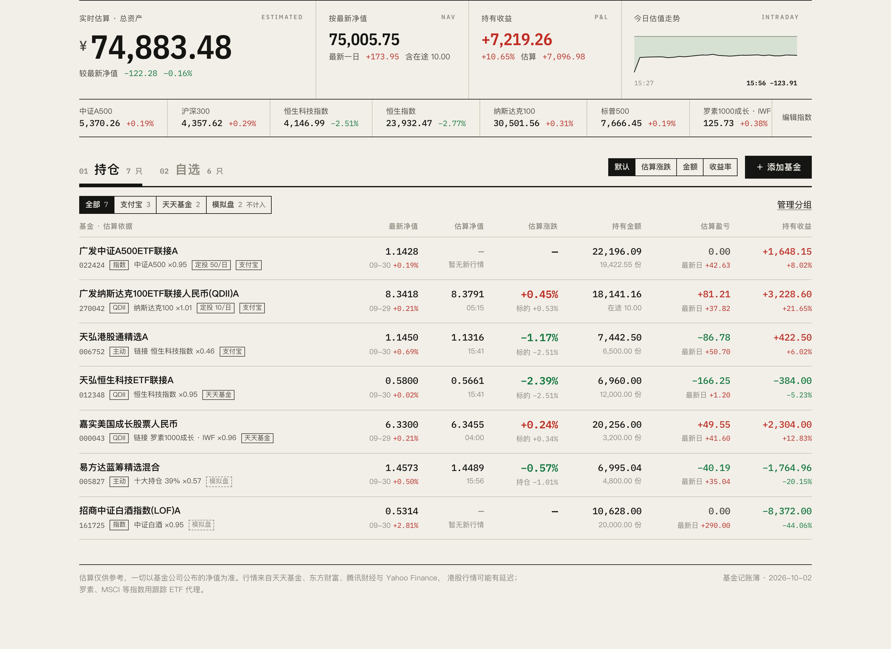
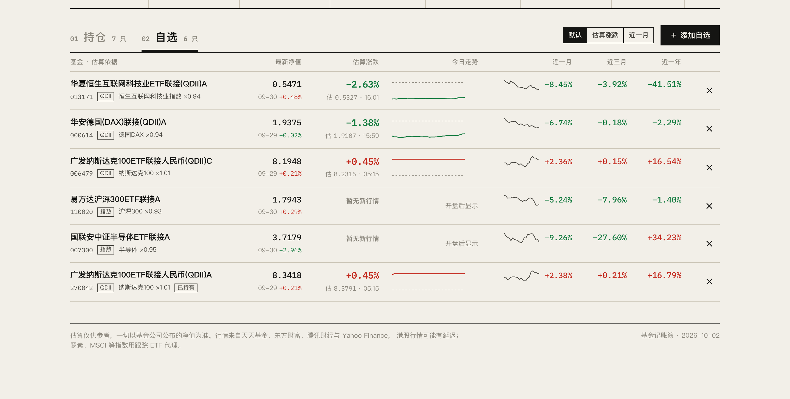
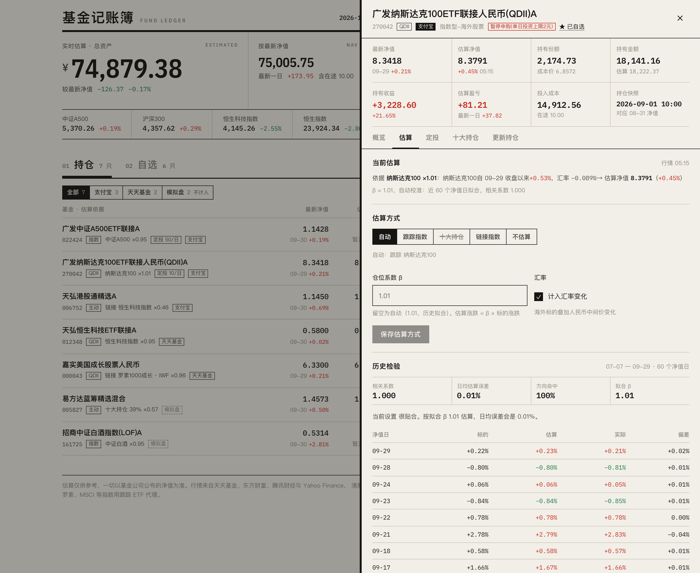
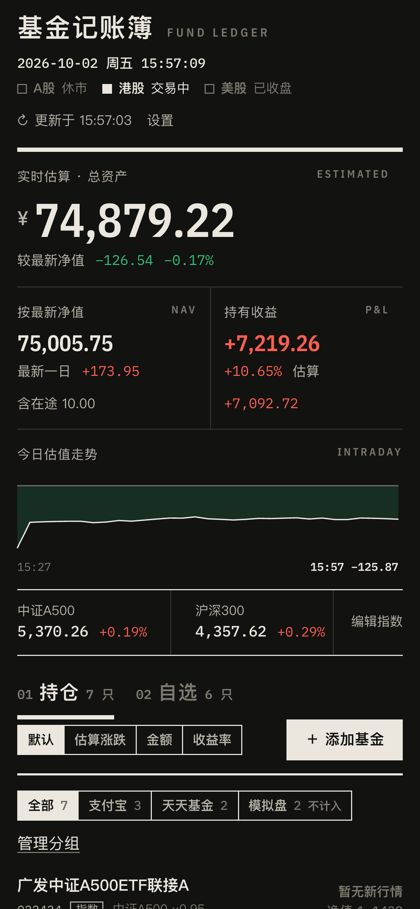

# 基金记账簿：一个更好的养基宝

盘中实时估算你在支付宝、天天基金等平台买的每一只基金——宽基指数、纳斯达克 QDII、港股主动基金都行。持仓可以按平台分组，没买的基金也能加进自选盯着。估算方式可以自己挑：跟踪指数、前十大重仓股，或者链接到任意指数，每种估法的历史误差都看得见；基金公司公布净值后自动对账，定投、手续费、份额确认也都替你记着。自己部署，数据只存在你自己的电脑或服务器上。





<p align="center">
  
  
</p>

<p align="center"><sub>截图中的持仓为示例数据</sub></p>

## 能做什么

- **实时估算净值**：指数基金跟踪自己的指数（中证A500、纳斯达克100、恒生科技、德国DAX……）；主动基金按最近一期季报的前十大重仓股加权；任何基金都可以「链接」到你认为走势相近的指数、ETF 或股票，比如港股主动基金 → 恒生科技。
- **小众指数也能用**：罗素成长 / 价值、MSCI 全球 / 新兴市场 / 日本 / 印度等（用 iShares 等跟踪 ETF 代理），全球主要股指，黄金、原油。
- **QDII 更准**：净值晚一两天公布时，自动把中间几天的涨跌连乘进去，并按人民币中间价调整汇率；β 用最近 60 个净值日自动校准。纳斯达克100 联接基金实测日均误差约 0.01%。
- **看得见的误差**：每种估算方式都能查看过去 60 个净值日的相关系数、日均误差和方向命中率，决定要不要换一种估法。
- **自选**：不用填份额，把关心的基金加进自选，首页「自选」标签里就能看到它的实时估算、今天的估值走势，以及近一月 / 三月 / 一年的涨跌；持仓详情里点「☆ 加自选」也行。
- **持仓分组**：按平台或用途分开记账，比如支付宝、天天基金、模拟盘、默认分组，名字随便起。每个分组有自己的总资产、收益和估值走势；模拟盘这类分组可以设为不计入总资产。
- **照着平台录入**：填「持有份额 + 持仓成本价」或「持有金额 + 持有收益」。网站按录入时间判断这份快照对应哪天的净值、哪些定投已经确认进了份额（普通基金 T+1，QDII 通常 T+2）。
- **定投台账**：每日、每周、每两周、每月都行，按外扣法计算手续费和买到的份额；中途改金额不会影响已经发生的扣款。
- **一眼看全**：按最新净值和按实时估算的总资产、估算盈亏、持有收益，以及交易时段每分钟记录的估值走势。红涨绿跌（可切换），支持手机和深色模式。
- **多人使用**：用户名 + 密码登录，每个账户的持仓相互独立；管理员可以添加用户或开放注册。
- **很轻**：后端只用 Python 标准库，前端无需构建，1 核 512 MB 的小服务器就能跑。

## 在自己电脑上运行

需要 Python 3.10 或更高版本（macOS、Linux、Windows 都可以），不用安装任何第三方包。

```bash
git clone https://github.com/Naka152/fund-ledger.git
cd fund-ledger
python3 server/main.py --add-user 你的用户名 --admin   # 按提示设置密码
python3 server/main.py
```

浏览器打开 <http://localhost:8766>，用刚才的用户名和密码登录，点「＋ 添加基金」开始录入。

只在自己电脑上用、不想登录的话，可以关掉登录：

```bash
FL_AUTH=off python3 server/main.py
```

Windows 上把 `python3` 换成 `python`；关闭登录要先执行 `set FL_AUTH=off`（PowerShell 是 `$env:FL_AUTH="off"`）。

| 环境变量 | 默认值 | 说明 |
| --- | --- | --- |
| `HOST` | `127.0.0.1` | 监听地址 |
| `PORT` | `8766` | 端口 |
| `FL_DATA` | `./data` | 数据目录（持仓、账户、缓存） |
| `FL_AUTH` | `on` | 设为 `off` 关闭登录，只建议在本机使用 |

## 部署到服务器

下面以 Ubuntu / Debian + [Caddy](https://caddyserver.com) 为例，Caddy 会自动申请并续期 HTTPS 证书。

### 0. 准备

- 一台云服务器，在安全组 / 防火墙里放行 80 和 443 端口。
- 一个解析到服务器 IP 的域名。没有域名的话可以用免费的 [sslip.io](https://sslip.io)：`fund.1-2-3-4.sslip.io` 会自动解析到 `1.2.3.4`（把 IP 里的点换成横杠），不用注册。
- 中国大陆的服务器用域名访问需要 ICP 备案；香港和海外服务器不需要，行情接口在海外同样能用。

### 1. 安装依赖

```bash
sudo apt update
sudo apt install -y python3 git caddy
```

系统源里没有 `caddy` 的旧版本系统，按 [Caddy 官方文档](https://caddyserver.com/docs/install) 安装。

### 2. 下载代码并创建服务账户

```bash
sudo git clone https://github.com/Naka152/fund-ledger.git /opt/fund-ledger
sudo useradd --system --home-dir /opt/fund-ledger --no-create-home --shell /usr/sbin/nologin fundledger
sudo mkdir -p /opt/fund-ledger/data
sudo chown -R fundledger:fundledger /opt/fund-ledger
```

### 3. 创建管理员账户

```bash
sudo -u fundledger python3 /opt/fund-ledger/server/main.py --add-user 你的用户名 --admin
```

### 4. 注册为系统服务

```bash
sudo cp /opt/fund-ledger/deploy/fund-ledger.service /etc/systemd/system/
sudo systemctl daemon-reload
sudo systemctl enable --now fund-ledger
systemctl status fund-ledger
```

服务只监听 `127.0.0.1:8766`，以受限的 `fundledger` 账户运行，只能写 `/opt/fund-ledger/data`。

### 5. 配置 HTTPS

在 `/etc/caddy/Caddyfile` 末尾加上下面几行，把域名换成你自己的：

```caddyfile
fund.example.com {
	encode gzip
	reverse_proxy 127.0.0.1:8766
}
```

```bash
sudo systemctl reload caddy
```

等几秒钟证书签好，打开 `https://你的域名` 登录即可。用 Nginx 的话，把 `/` 反向代理到 `127.0.0.1:8766`，并传上 `X-Forwarded-For` 和 `X-Forwarded-Proto` 两个头。

### 更新与维护

```bash
cd /opt/fund-ledger && sudo -u fundledger git pull && sudo systemctl restart fund-ledger
```

也可以在本机改完代码后直接同步过去：`SERVER=root@服务器IP ./deploy/deploy.sh`。

- 查看日志：`journalctl -u fund-ledger -f`
- 所有数据都在 `/opt/fund-ledger/data`，备份这个目录即可。
- 账户管理（在网页「设置 → 用户管理」里也能做）：

```bash
sudo -u fundledger python3 /opt/fund-ledger/server/main.py --list-users
sudo -u fundledger python3 /opt/fund-ledger/server/main.py --add-user 新用户名
sudo -u fundledger python3 /opt/fund-ledger/server/main.py --set-password 用户名
```

## 估算是怎么算的

**估算净值 = 最新净值 × (1 + β × R)**

- **R** 是估算标的相对「最新净值那天收盘价」的人民币涨跌。标的在净值日之后还没有新交易日时 R 为 0；QDII 净值滞后时把中间几天的涨跌连乘；海外标的再乘上人民币中间价的变化。前十大持仓估算用十大重仓股的加权涨跌代表整个股票仓位。
- **β** 默认取业绩基准里的指数比例（指数基金通常 0.95）或最近一期的股票仓位（主动基金），再用最近 60 个净值日做回归自动校准；也可以手动填写。
- 基金公司公布净值后一律以公布值为准，估算只作参考。

**数据来源**：腾讯财经（实时行情）、天天基金 / 东方财富（基金资料、净值、持仓、证券搜索）、中国外汇交易中心（人民币中间价）、Yahoo Finance（备用）。某个来源暂时不可用时会自动换用下一个。港股行情可能有约 15 分钟延迟。

## 目录结构

```
server/            后端，只用 Python 标准库
  main.py          HTTP 服务、接口、登录、命令行工具
  auth.py          账户（scrypt 密码哈希）、会话、登录限速
  portfolio.py     持仓、定投台账、组合估值
  estimate.py      估值引擎、历史检验、β 自动校准
  fundsrc.py       基金列表、净值、资料、十大持仓、跟踪指数识别
  market.py        实时行情、日 K、人民币中间价，多数据源自动切换
  tradecal.py      A 股交易日历与市场状态
  recorder.py      交易时段每分钟记录组合估值
  catalog.py       常用指数目录（含罗素、MSCI 的 ETF 代理）
web/               前端：Preact + htm（已内置，无需构建）、样式、字体
deploy/            systemd 服务、Caddy 配置示例、同步部署脚本
```

## 说明

本项目仅供个人记账与学习交流，估算结果不构成任何投资建议。项目与养基宝、支付宝及蚂蚁集团没有任何关联。

第三方组件：[Preact](https://preactjs.com)（MIT）、[htm](https://github.com/developit/htm)（Apache-2.0）、[IBM Plex](https://github.com/IBM/plex) 字体（SIL OFL 1.1），许可证见 `web/vendor/` 与 `web/fonts/`。
